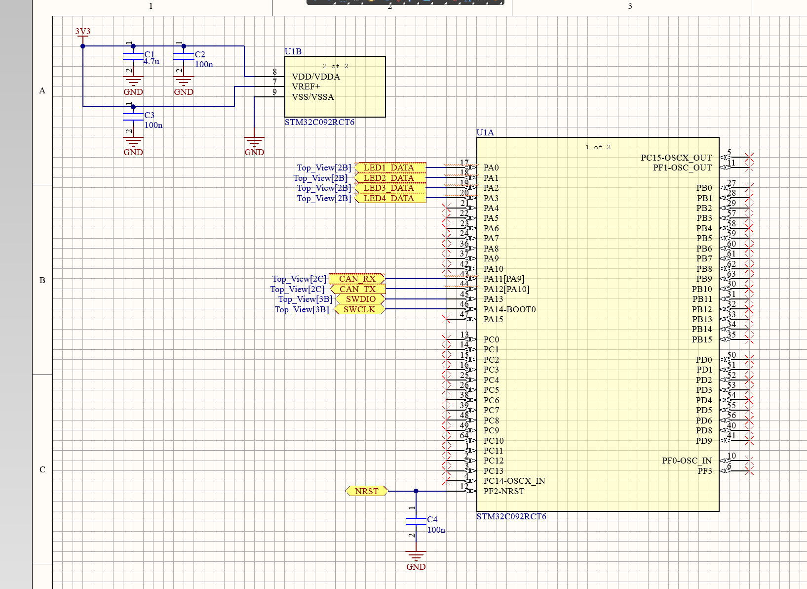
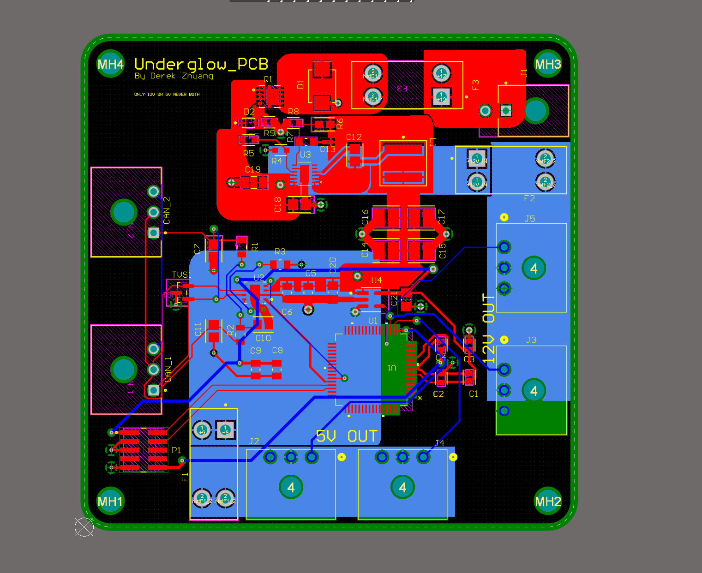
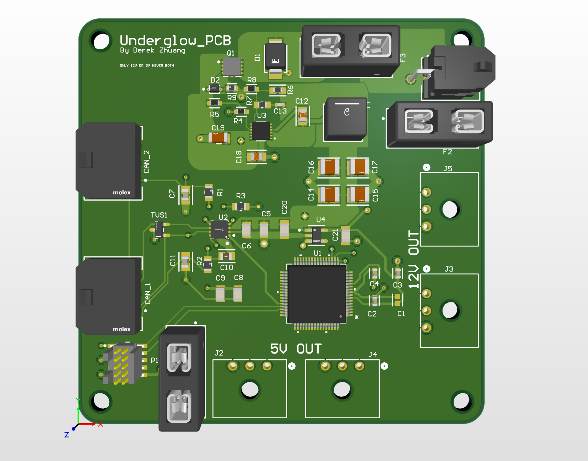

# BOLT Underglow Board Firmware

Firmware for the underglow LED driver board on BOLT Electric's (Virginia Tech) electric motorcycle. The board drives two addressable LED strips, powered at either 5V or 12V, and talks to the rest of the bike over CAN.

> Status: TODO (one of: schematic only / board assembled, bring-up in progress / running on the bike). Update this line every time it changes.

## Hardware

| Item | Detail |
|---|---|
| MCU | STM32C092RCT6 (Cortex-M0+, 48 MHz, LQFP64) |
| Clock | Internal HSI48, no crystal |
| LEDs | 2 strips, one-wire data at 800 kHz. Either 5V strips (WS2812B, 30 LEDs each, outputs J2 and J4) or 12V strips (TODO: strip type, outputs J3 and J5). Use one voltage at a time, never both (printed on the board silkscreen) |
| LED data | LED1_DATA to LED4_DATA on PA0 to PA3, timer + DMA, through a level shifter (TODO: confirm which nets drive which connector) |
| CAN | FDCAN1 on PA11/PA12 via MCP2562FD transceiver (TODO: confirm vs PD0/PD1 with the team) |
| Debug | SWD, 10-pin connector |
| PCB | Altium Designer, 4-layer. Design files: TODO (link, or "kept private by the team") |

## Photos

Screenshots and renders from Altium Designer. See the Status line above for how far the physical board has got.

**MCU schematic sheet** (STM32C092RCT6 with decoupling, LED data, CAN, SWD, and reset nets)



**PCB layout** (Altium PCB editor)



**3D render**



## What the firmware does

- TODO: one line per feature that actually works today. Example format: "Drives both strips with DMA-fed PWM, no CPU bit-banging."
- TODO: CAN messages it listens for and what each one does (ID, payload, effect).
- TODO: brightness cap and why (strip current is about 1.8 A per strip at full white).

## What I wrote vs what is generated

- Generated by STM32CubeMX: clock tree, pin setup, peripheral init (`Core/Src/main.c` init functions, `Drivers/`).
- Written by me: TODO (for example the WS2812B frame encoder, effect engine, CAN message handler, brightness limiter).

State this plainly. Reviewers can tell, and it protects you in interviews.

## Build and flash

```
Toolchain: STM32CubeIDE (version TODO)
Programmer: ST-LINK over SWD
1. Clone the repo
2. Open the project in STM32CubeIDE
3. Build, then Run/Debug with the ST-LINK attached
```

## Testing

- TODO: what you measured and how. Only list results you actually have.
  - Example: "Scope capture of the data line shows T0H/T1H within the WS2812B spec" (add the screenshot to `docs/`).
  - Example: "Tested CAN at 500 kbps against TODO node, no errors over TODO minutes."

## Known issues / next steps

- TODO: honest list. Examples: CAN bit timing not yet verified across temperature on HSI48; effects limited to TODO.

## Repo layout

```
firmware/UnderglowBoard/    STM32CubeIDE project (.ioc included)
docs/                       Pinout, CAN message table, scope captures, photos
hardware/                   Schematic PDF and board photos (not raw team files unless approved)
```

## Credits and license

Part of BOLT Electric at Virginia Tech. Board and firmware by Ziheng "Derek" Zhuang, with guidance from TODO (lead). License: TODO (MIT is fine for personal code; ask the team if they want it restricted).
